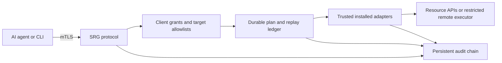

# Scoped Resource Gateway (SRG)

SRG is an experimental, transport-neutral control contract with a Python
reference implementation for AI agents managing infrastructure. It is a
proposed community framework, not an industry standard or an audited security
product. The reference implementation uses mutual TLS and the Python standard
library (Python 3.11+), with no subscription or cloud dependency.

An agent gets named capabilities, not a root shell or a vault export. The
operator installs trusted adapters and defines exact target allowlists. Each
client certificate has its own explicit write grants; read authorization does
not automatically grant writes. A plan previews a change, and an apply request
consumes that short-lived plan. Every request and execution phase is audited.



## Start with the contract

See [PROTOCOL.md](PROTOCOL.md) for exact routes, schemas and failure semantics.
The client is optional; any agent with HTTPS/mTLS support can use the protocol.
An MCP wrapper could expose the same capabilities, but is not implemented here.
The server cannot prove that a request came from a particular model or that a
human asked for it: possession of an authorized client key is the authority.
Keep agent instructions explicit: mutate only when the owner asks. Issue distinct
client certificates for distinct agents/operators when separate attribution is
needed; one shared machine certificate cannot distinguish chats or models.

A read-only client can inspect resources but receives no actions from the
capability catalog. A writer sees only its granted actions and allowed targets:

```sh
python3 client.py --config client.json --capabilities
python3 client.py --config client.json --plan app-restart --target demo-app
# Inspect the response; then use its returned opaque plan ID:
python3 client.py --config client.json --apply PLAN_ID
python3 client.py --config client.json --status PLAN_ID
python3 client.py --config client.json --audit
```

Planning itself does not mutate the resource. Applying routine actions does
not require a new vault unlock or a browser confirmation. This is a security
boundary, not a universal interactive approval broker. Destructive operations
have no implementation or grant; a human must use a separately authorized
administrative channel. A JSON `approved: true` cannot override the policy.

## Reference adapters

| Adapter | Supported writes | Restrictions |
|---|---|---|
| SSH executor | Start/restart existing Docker containers; start/gracefully shut down existing Proxmox VMs | Exact target names/IDs; no image pulls, command execution, volume changes, deletion, or forced VM stop |
| Home Assistant | Turn exact allowlisted lights, switches, fans, or input booleans on/off | No wildcards, areas, arbitrary service data, scripts, locks, alarms, or entity creation |

The HTTP read adapters are separate from mutation adapters. Backend tokens
stay in server credential files. Responses are projected onto allowed fields,
not forwarded wholesale. Infrastructure/resource names and entity states are
still untrusted data, never agent instructions.

SSH target operations are checked twice: once in gateway policy and again in
root-owned policy on the target. The remote authorized key is source-restricted
and forced to a root-owned executor. The executor runs fixed argv lists without
shell evaluation, validates preconditions while holding a lock, verifies the
result, and logs each command with the plan ID to AUTHPRIV/syslog.

Container restart allows Docker's normal 30-second graceful-stop window,
after which Docker may kill the selected container. Only explicitly suitable
application containers should be allowed; databases and critical infrastructure
should remain excluded. Graceful VM shutdown explicitly sets `--forceStop 0`.
Home Assistant lacks a compare-and-swap service API: it is rechecked immediately
before the call, but external changes can still race that call.

## Deploy your own instance

The release exporter includes only portable source, tests, this guide, the
protocol, license and generic examples. It excludes the first deployment's
inventory, fingerprints, host keys, policy and credentials:

```sh
python3 make-release.py --output /tmp/srg-reference.tar.gz
```

1. Install Python 3.11+, OpenSSL and OpenSSH from your OS packages. Run the tests:
   `python3 -m unittest discover -p 'test_*.py'`. Tests use ephemeral certificates
   and fake resource adapters; they do not contact infrastructure.
2. Generate a client private key and CSR on the client. Never send its private
   key to the server. On the server, run `provision.py --openssl /usr/bin/openssl
   --client-csr /path/client.csr --directory /etc/srg --bind SERVER_IP
   --hostname gateway.example.internal` as root. It refuses replacement of an
   existing installation. Copy only the resulting client certificate and CA
   certificate back. Leaf certificates require renewal after one year.
3. Install `gateway.py`, `control.py`, `action_adapters.py` and `audit.py` in
   `/etc/srg`, root-owned and not writable by the service. Start with the generated
   policy and no actions. Review `examples/policy.json` when adding actions;
   replace its dummy fingerprint with the SHA256 of the client's DER certificate.
   Keep the bootstrap client fingerprint and add `actions`, `write_grants`, and
   `state_database` explicitly. Do not blindly replace generated policy.
4. Use `examples/srg.service` as a systemd starting point. Supply each required
   credential with `LoadCredential`, create a mode-0700 state directory, restrict
   network reachability to your management network, and validate server DNS/CA.
   Configure the client using `examples/client.json` with your local paths.
5. For SSH writes, install `ssh_action.py` root-owned at
   `/usr/local/libexec/srg-action.py`, mode 0755; install exact operation/target
   mappings as root-owned mode-0600 `/etc/srg-actions.json`. The executor expects
   Linux Docker and/or Proxmox CLI paths. Create a dedicated unprivileged remote
   account, give it only sudo for `/usr/bin/python3 -I
   /usr/local/libexec/srg-action.py`, and use a separate gateway SSH key with:

   ```text
   from="GATEWAY_IP",restrict,command="test \"$SSH_ORIGINAL_COMMAND\" = action && exec sudo -n /usr/bin/python3 -I /usr/local/libexec/srg-action.py" ssh-ed25519 PUBLIC_KEY
   ```

   Pin authenticated host keys in a root-owned known-hosts file. Do not disable
   host checking. Change policy only through your trusted configuration manager.
6. Preview allowed actions. Verify ungranted clients, unknown targets, malformed
   bodies, replayed plans and destructive operations are rejected. First execute
   an idempotent/no-op action, then a low-impact action on a test resource. Confirm
   the audit entries and target state before expanding any grants.

The example service runs without root privileges or a local Docker socket.
Its state directory contains the audit and plan ledger, and must survive
service restarts and deployments. Credentials must not be embedded in policy,
source, Nix derivations, logs, Git, or command-line arguments.

## Audit operations

The primary ledger is SQLite at the configured `state_database`. It records
client identity, sequence, time, event, action/target/plan correlation and
outcome. Backend request headers, credentials, full API payloads and command
output are not logged. The reference HTTP server additionally writes request
summaries to stdout/journald; TLS handshake failures go to journald. The remote
executor logs commands and exit codes with the same plan ID on the target.

```sh
python3 audit.py --database /var/lib/srg/control.sqlite3
python3 audit.py --database /var/lib/srg/control.sqlite3 --export
python3 audit.py --database /var/lib/srg/control.sqlite3 --backup /secure/new-backup.sqlite3
journalctl -u srg
journalctl -t srg-action
```

The backup command uses SQLite's online backup API and creates a mode-0600 file.
Do not copy an active SQLite file with ordinary `cp`. The full audit is retained;
only abandoned previews older than a day are removed. Monitor disk space and
archive verified backups according to your retention policy. Audit insertion
failure blocks execution. After a post-execution failure, inspect target state
and the plan ledger; never assume that an HTTP error means nothing happened.

Entries are hash chained for corruption/tampering detection. This is **not**
immutable storage: an administrator can rewrite the database and recompute the
chain, and unanchored tail truncation cannot be detected. Export checkpoints or
ship logs to an independently administered collector for stronger guarantees.
No off-host collector, retention scheduler or alerting service is bundled.
Auditing starts when this version is activated; it cannot retroactively record
prior bootstrap work or commands executed outside SRG.

## Extending the framework

Register a trusted adapter instance in the server's adapter registry. Implement:

- `validate(action)`: reject unsupported operations, unsafe origins, identifiers
  and target scopes during startup. Never accept caller-defined code or URLs.
- `prepare(action, target)`: return a minimal JSON precondition snapshot without
  mutating. Include stable identity/version information, not secrets.
- `execute(action, target, before)`: recheck when possible, execute exactly the
  installed operation, then verify the resulting state. Raise on uncertainty;
  never automatically retry a mutation. The controller supplies `request_id`
  and an `audit(event, detail)` callback; record each backend step without secrets.

Add conformance tests for client isolation, scope denial, changed preconditions,
expiry, restart/replay, ambiguous failures, input injection and audit failure.
An adapter is trusted code and can defeat the boundary if implemented badly;
plugins are installed and reviewed by the operator, never uploaded by an agent.
See [CONTRIBUTING.md](CONTRIBUTING.md) before proposing new operations.

## Maturity and limitations

Version 0.1 is an initial reference implementation, not a certified product.
It uses a single-process HTTP server: a long-running action delays other requests.
Plans expire after 120 seconds and allow at most one execution attempt. External
resource changes, backend failures, process crashes and network loss prevent
exactly-once guarantees. There is no HA cluster, multi-node ledger, job queue,
interactive human-approval service, signed log anchoring, or automatic expiry
monitor. Existing adapters intentionally cover a small routine-action set.

GitHub Actions runs the reference tests and tests a fresh exported archive on
pushes and pull requests. The workflow has read-only repository permissions.

MIT licensed. Deployment inventories, credentials, client identities and audit
data belong in separate private operator-managed configuration.
